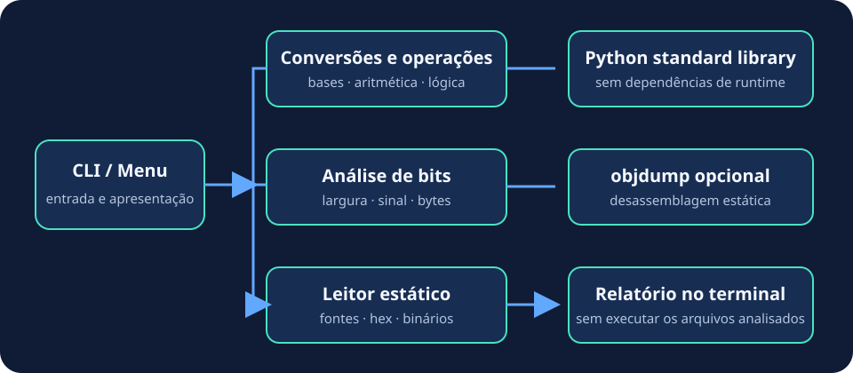

<p align="center">
  
</p>

**BinLab 0.3.1** · Python 3.8+ · Linux · Licença MIT

BinLab é uma aplicação de terminal e desktop para aprender operações numéricas e lógicas, converter bases e inspecionar estaticamente dados binários, dumps hexadecimais, fontes C e assembly.

> **Evolução em andamento:** o projeto está sendo organizado como BinLab Engineering, um laboratório local-first de engenharia computacional. A implementação será incremental; os módulos Web, API e desktop Tauri ainda não fazem parte da versão atual.

## Recursos atuais

- Aritmética inteira e operações lógicas bit a bit.
- Conversão entre binário, octal, decimal e hexadecimal.
- Análise de largura, sinal, bytes e caracteres ASCII.
- Leitura estática de fontes C/assembly, dumps hex e arquivos binários.
- Desassemblagem opcional com GNU `objdump`.
- Interface gráfica desktop em Tkinter, sem dependências Python extras de runtime.

## Requisitos atuais

- Python 3.8 ou superior.
- GNU `objdump` opcional para desassemblagem; sua disponibilidade depende do formato e da arquitetura.

## Instalação e execução

```bash
python3 -m venv .venv
source .venv/bin/activate
python -m pip install .
binlab
```

Para abrir a interface gráfica depois de instalar:

```bash
binlab-gui
```

Tkinter vem com muitas distribuições Python. Em alguns Linux, pode ser necessário instalar o pacote do sistema `python3-tk`.

Também é possível executar sem instalar, a partir da raiz do repositório:

```bash
python3 src/halfAdder.py
# ou
PYTHONPATH=src python3 -m binlab
# GUI no checkout:
PYTHONPATH=src python3 -m binlab.gui
```

O banner do terminal colore o nome e a legenda em ANSI quando a saída é interativa. Defina `NO_COLOR=1` para desativar as cores.

## Testes

```bash
python -m unittest discover -s tests -v
```

O CI executa compilação, instalação, testes e build das distribuições em Python 3.8 e 3.13.

## Estrutura atual

```text
src/binlab/domain/ regras puras para conversão, operações e análise
src/binlab/        adaptadores CLI/GUI e leitura estática
src/halfAdder.py   ponto de entrada legado
doc/               documentação da versão atual
docs/              arquitetura, auditoria e plano de evolução
images/            logo e diagrama SVG
.github/workflows/ integração contínua, tags e releases
tests/              testes unitários
```



## Documentação

- [Objetivo e escopo atual](doc/objetive.md)
- [Arquitetura atual](doc/architecture.md)
- [Plano de entregas BinLab Engineering](docs/ROADMAP.md)
- [Arquitetura alvo](docs/architecture/overview.md)
- [Contratos](docs/contracts/README.md)
- [Modelo de ameaças](docs/security/threat-model.md)
- [Auditoria técnica de 2 de novembro de 2026](docs/audit/2026-11-02-code-review.md)
- [Licenciamento](docs/legal/LICENSING.md)
- [Política de privacidade](docs/legal/PRIVACY.md)
- [CI/CD, tags e versões](doc/ci-cd.md)
- [Interface gráfica atual](doc/gui.md)
- [Política de segurança](SECURITY.md)
- [Como contribuir](CONTRIBUTING.md) · [Histórico](CHANGELOG.md)

## Limites e segurança do leitor

O leitor faz inspeção estática e não executa nem compila os arquivos importados. Os limites atuais são: fonte 2 MiB, binário 8 MiB, texto HEX 4 MiB, saída decodificada HEX 1 MiB, lacuna Intel HEX 64 KiB, saída combinada do objdump 64 KiB e timeout de 20 segundos. Strings retornadas são limitadas a 30 ocorrências de até 160 caracteres. A análise de bits e as operações de domínio também possuem limites de largura.

O parser Intel HEX exige EOF único e terminal, valida checksum e estrutura dos registros, rejeita sobreposições e evita materializar endereços esparsos fora dos limites. O objdump é iniciado sem shell, com ambiente reduzido e saída drenada sob teto de memória.

Esses controles reduzem riscos de exaustão de recursos, mas não equivalem a sandbox de execução. Não use o BinLab como ambiente de execução de arquivos não confiáveis. A inspeção via API permanece bloqueada até revisão e validação da nova implementação no CI.

## Estrutura atual

```text
src/binlab/domain/ regras puras para conversão, operações e análise
src/binlab/        adaptadores CLI/GUI e leitura estática
src/halfAdder.py   ponto de entrada legado
doc/               documentação da versão atual
docs/              arquitetura, auditoria e plano de evolução
images/            logo e diagrama SVG
.github/workflows/ integração contínua, tags e releases
tests/              testes unitários
```


## Documentação

- [Objetivo e escopo atual](doc/objetive.md)
- [Arquitetura atual](doc/architecture.md)
- [Plano de entregas BinLab Engineering](docs/ROADMAP.md)
- [Arquitetura alvo](docs/architecture/overview.md)
- [Contratos](docs/contracts/README.md)
- [Modelo de ameaças](docs/security/threat-model.md)
- [Auditoria técnica de 2 de novembro de 2026](docs/audit/2026-11-02-code-review.md)
- [Licenciamento](docs/legal/LICENSING.md)
- [Política de privacidade](docs/legal/PRIVACY.md)
- [CI/CD, tags e versões](doc/ci-cd.md)
- [Interface gráfica atual](doc/gui.md)
- [Política de segurança](SECURITY.md)
- [Como contribuir](CONTRIBUTING.md) · [Histórico](CHANGELOG.md)

## Limites atuais

O leitor não executa nem compila os arquivos. As estatísticas de C/assembly são heurísticas. Um executável compilado não contém necessariamente o código C original; a desassemblagem depende dos formatos e processadores suportados por `objdump`.

A auditoria identificou limites de tamanho e memória que precisam ser corrigidos antes de disponibilizar a inspeção pela API. Consulte o relatório técnico. A aplicação instalada é local-first; o repositório é hospedado pelo GitHub, sujeito às políticas desse provedor.
