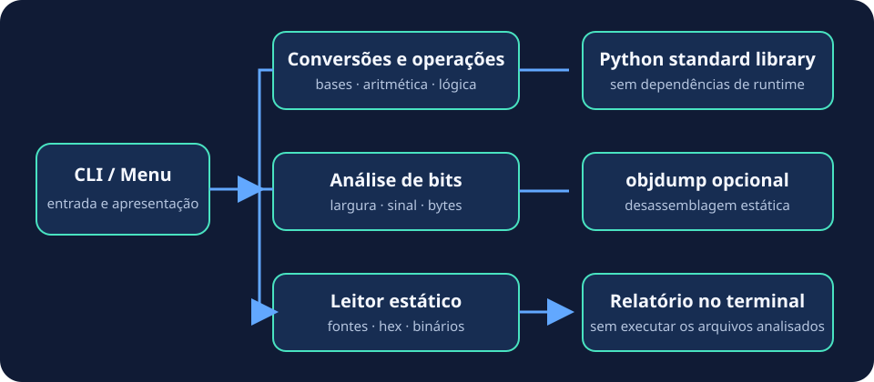

# Arquitetura

BinLab é organizado como pacote Python com interface de terminal, lógica de operações e leitor de artefatos. O fluxo esperado é entrada do usuário → validação → operação/leitura → apresentação de resultados.

```text
src/binlab/
├── __init__.py          versão do pacote
├── __main__.py          execução com python -m binlab
├── cli.py               menu e operações numéricas
└── artifact_reader.py   leitura estática de C, assembly, HEX e bytes
```

## Módulos

- `cli.py` valida entradas da calculadora e apresenta conversões, operações, tabela verdade e análise de bits.
- `artifact_reader.py` lê fontes como texto, decodifica texto hexadecimal e apresenta propriedades de arquivos binários. Chama `objdump` como processo externo somente para desassemblagem estática.
- `__main__.py` e o script de console `binlab` encaminham para a mesma função `main`.
- `src/halfAdder.py` preserva compatibilidade com o caminho de execução antigo.



O pacote usa apenas a biblioteca padrão do Python em tempo de execução. O `pyproject.toml` define metadados, versão, construção e comando de console.
